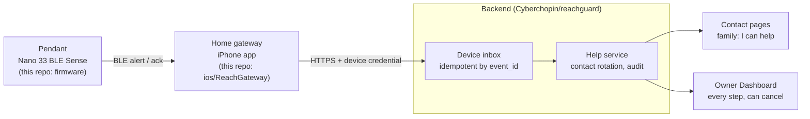
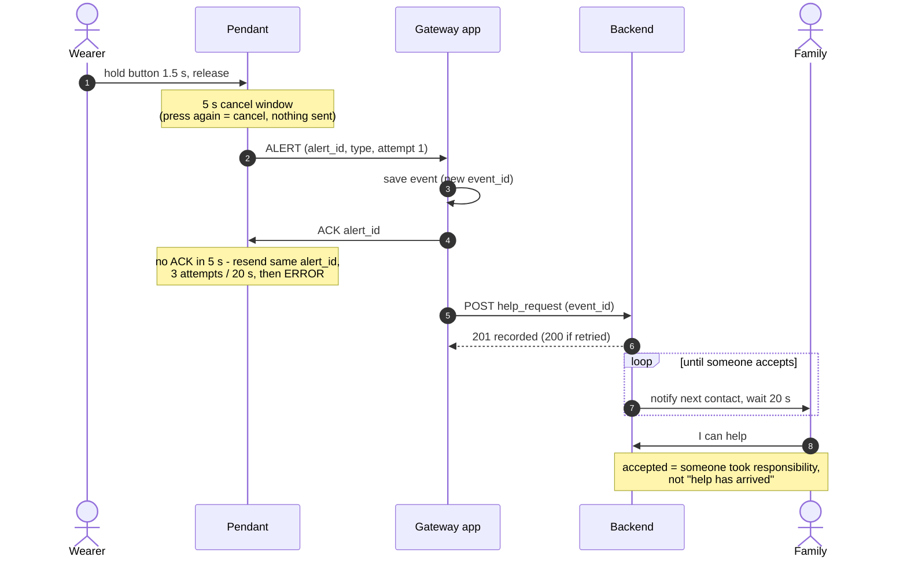

# Reach

[](https://github.com/Iridium0317/WearableEmergencyAssistanceSystem/actions/workflows/ci.yml)

Reach is an educational prototype of a wearable emergency-alert controller on
an Arduino Nano 33 BLE Sense Rev2 (nRF52840, Cortex-M4, Mbed OS). It is **not** a medical device
and does not contact emergency services itself: it raises alert events over BLE,
and a host application decides what to do with them (call, message, etc.).

Status and measured results: see [TEST_RESULTS.md](TEST_RESULTS.md).

## End-to-end system (ReachGuard)

The wearer only has the pendant; they are not expected to own or use a
smartphone. A home gateway relays alerts to the internet. In this prototype the
gateway is an iPhone running `ios/ReachGateway`, standing in for a spare phone
kept plugged in at home (later: a small dedicated hub, or a cellular pendant
that needs no gateway). Family members respond on the contact page; a primary
family member (the "owner" role, e.g. the wearer's son) follows every step on
the Dashboard.



### Life of one alert



First full run on 2026-10-18 (TEST_RESULTS.md T14): a D2 Emergency hold went
from the wearable over BLE to a real iPhone, was uploaded (HTTP 201), and the
contact accepted it on the contact page. "Contact accepted" means someone took
responsibility; it does not mean help arrived.

## Using the pendant

| Button | Pin | Alert type |
|---|---|---|
| Left | D2 | Emergency |
| Middle | D3 | Medical |
| Right | D4 | Family |

The type reaches the gateway app. The backend does not store it yet, so all
three buttons currently notify the same contacts.

1. **Hold a button for at least 1.5 s, then let go.** Shorter presses do nothing.
2. **5 s cancel window** (LED fast blue blink), timed from the release. Pressing
   any button cancels; nothing is sent (LED steady white).
3. **Sending** (LED steady blue) until the gateway ACKs.
4. **Delivered to the gateway** (LED steady green).
5. **Not delivered** (LED slow red blink): no ACK within 20 s / 3 attempts. It
   stays red; holding a button again starts a new alert.

Edge cases:

- **Contact bounce:** edges within 30 ms are filtered, so one press is one press.
- **Held and never released** (e.g. the wearer is lying on the button): the
  alert still goes out 1.5 s + 5 s after the press began.
- **Two buttons at once:** the second press is the cancel gesture for the
  first. To switch, let go and hold the intended button.
- **Cancel after sending:** a press while sending or retrying (before the
  ACK) cancels on the pendant and sends a CANCEL packet once, best effort. After
  the ACK (green) a press no longer cancels. CANCEL is
  not acknowledged in this protocol version, and the backend does not act on it
  yet; the owner cancels on the Dashboard.

LED: off = idle · fast blue blink = cancel window · steady blue = sending ·
green = gateway has it · white = cancelled · slow red blink = not delivered.

## Design decisions

Each decision, why it was made, and where it is tested.

| Decision | Why | Evidence |
|---|---|---|
| A deliberate 1.5 s hold, then a 5 s cancel window before anything is sent | False alarms are the main failure of alert buttons; short presses and contact bounce must never alert, and a wrong press must be undoable | T6–T8 |
| An explicit application ACK for every alert | A BLE notification is not a delivery confirmation; only the gateway's ACK counts | T5, T9 |
| Bounded retries (3 attempts, 20 s), then a sticky ERROR | The wearer must never see "sent" for an alert nobody received; failure is shown, not hidden | T5, T10 |
| No attempt is spent while the gateway is not listening | Found on the bench: retries burned while the host reconnected, failing 2 of 10 redeliveries. Sends now need connected **and** subscribed, and resend the moment it subscribes | T10 |
| The gateway saves an alert before it ACKs | An ACK is a promise to keep the alarm; if the phone cannot save it, no ACK is sent and the pendant falls back to ERROR | T13, T15, T17 |
| `event_id`: attempt 1 always creates a new ID, a retry reuses it | `alert_id` restarts at 1 after a board reset, so it cannot be the identity; retries must not create a second help request (the backend also answers 200 for a repeated ID) | T15 |
| Upload retries transient failures with the same ID, and stops on credential or schema errors | Retrying cannot fix a wrong credential; the reason is shown and a manual retry keeps the original ID | T13 |
| "Received", "recorded" and "accepted" are three different claims | BLE ACK = the gateway has it; HTTP 201 = the backend recorded it; accepted = a contact took responsibility. None of them means help arrived, and the UI wording says so | T14 |
| The gateway is silent | It stands in for a device left at home; telling family is the backend's job | — |
| Rotation lives in the backend; the wearer presses once | Keep the wearer's side simple and put the complexity in the system: close family first, alternating, then others, round after round until someone accepts. After downtime it resumes one step at a time instead of firing every missed notification | Backend PR #5 |
| Pure logic is separate from hardware | State machine, debouncer, packet protocol and gateway rules run as host unit tests; timers are overflow-safe | T1, T3, T12 |
| Least-privilege credentials | The gateway holds only the device credential (iOS Keychain); contacts, owner and dashboard have separate roles; nothing is committed | — |

## Firmware architecture

```
GPIO ISR ───────┐
serial console ──┼─► AppEventQueue (rtos::Mail, ISR-safe) ─► app thread
BLE callbacks ───┘                                            ├─ StateMachine (pure, host-tested)
                                                              └─ AlertTransport: BleLink | SimulatedLink
```

- `lib/app` — event types and the alert state machine (transition table in `state_machine.h`)
- `lib/button_logic` — debounce and deliberate-hold detection
- `lib/protocol` — BLE packet encoding/validation
- `src/app` — event queue and the controller thread
- `src/drivers` — buttons (D2 Emergency, D3 Medical, D4 Family), status LED, BLE GATT transport
- `src/services` — diagnostics log, serial console, simulated link

The app thread is the only thread that touches the state machine and ArduinoBLE,
and it runs at `osPriorityBelowNormal` so Cordio's `bleLoop` thread can preempt it
(see TEST_RESULTS.md T4 for why this matters).

## BLE GATT service

Advertised name `WEA-Nano33`. No pairing (prototype only).

| Characteristic | UUID | Properties | Payload |
|---|---|---|---|
| Service | `8f1d0001-6c2a-4b7e-9e3d-5a4c3b2a1f00` | | |
| Alert | `8f1d0002-…` | read, notify | 6 B: version, type (1 ALERT / 2 CANCEL), alert_id (u16 LE), alert type (1 Emergency, 2 Medical, 3 Family), attempt |
| Ack | `8f1d0003-…` | write | 4 B: version, 0x81, alert_id (u16 LE) |
| Status | `8f1d0004-…` | read, notify | 6 B: version, state, alert_id (u16 LE), alert type, attempts |

Notifications are not delivery-confirmed by BLE, so an alert counts as
delivered only when the host writes an Ack. Unacknowledged alerts are retried
(3 real transmissions max, 5 s ack timeout, 2 s backoff) within a 20 s delivery
budget from the first send, and then end in a sticky ERROR. Before every send
the firmware checks that the host is connected **and** subscribed to Alert; if
not, nothing is transmitted and no attempt is used. The moment the host
subscribes, a pending retry is sent without waiting for the backoff.

Requirements and limits the host (iPhone gateway) must respect:

- **Deduplicate by `alert_id`.** Every retry of one alert reuses its
  `alert_id` (only `attempt` changes, 1..3), and a late ack from an earlier
  attempt still counts. The host must create at most one event per
  `alert_id`. IDs live in RAM and restart at 1 after a board reset, so dedup
  must be scoped to the current connection or boot, not kept forever.
- **CANCEL is not acknowledged.** It is sent once, best effort. A successful
  BLE send only means the packet was handed to the BLE stack; it does not mean
  the host received it or stopped the alert. If the send fails the firmware
  logs `cancel_delivery=unknown`. There is no CANCEL ack in this protocol
  version.
- **An ack only means the host accepted the alert**, not that a caregiver saw it.
- **A late ack after ERROR is not accepted.** The firmware stays in ERROR and
  logs `late_ack_after_error=1` with the alert id.

## Build and test

CI (`.github/workflows/ci.yml`) runs the host tests, both firmware builds and
the iPhone gateway unit tests on every push and pull request.

```sh
pio test -e native                    # host unit tests
pio run -e nano33ble -t upload        # BLE firmware
pio run -e nano33ble_sim -t upload    # serial-only build with a simulated link

python3 -m venv .venv && .venv/bin/pip install -r tests/bench/requirements.txt
.venv/bin/python tests/bench/ble_bench.py   # needs the nano33ble build
.venv/bin/python tests/bench/bench.py       # needs the nano33ble_sim build
```

Serial console commands (115200 baud): `ping`, `reboot`, `hold <1-3>`, `press`,
`ack <id>`, `link up|down` (sim build only).

## iPhone gateway app

`ios/ReachGateway` is a SwiftUI app (iOS 17+) that connects to `WEA-Nano33`,
stores each alert on the phone, writes the BLE Ack, and uploads a
`help_request` to the backend, retrying with the same `event_id` until it gets
201/200. A retransmission (`attempt` > 1) reuses its event; `attempt` 1 always
starts a new one, so a board reset cannot merge alarms. 401/403/409/413/422
stop retrying and show the reason.

```sh
brew install xcodegen
cd ios/ReachGateway && xcodegen generate     # project.yml -> ReachGateway.xcodeproj
xcodebuild test -project ReachGateway.xcodeproj -scheme ReachGateway \
  -destination 'platform=iOS Simulator,name=<any iPhone>'   # 22 unit tests
```

Run on a phone: open the project in Xcode, pick your team under Signing &
Capabilities, select the iPhone, Run. With a free Apple ID the install expires
after 7 days. In the app's settings enter the backend base URL (without
`/api/device-events`) and the device credential; the credential is kept only in
the iOS Keychain and is never committed. "Test tools → Skip the next ACK"
forces one retransmission for testing.

## Validation summary

| Area | Result | Record |
|---|---|---|
| State machine, debouncer, protocol (host) | Unit tests pass | T1, T3 |
| Real buttons, LED, cancel, simultaneous holds | Pass on hardware | T6–T8 |
| BLE alert/ack with a Mac host, retry on reconnect | Pass | T5, T9, T10 |
| BLE happy path ×100 | 100/100 | T11 |
| iPhone gateway unit tests | 15/15, then 22/22 with store-then-ack tests | T12, T17 |
| First real iPhone run, upload 201 | Pass | T13 |
| Full chain to "Contact accepted" | Pass | T14 |
| Backend offline, app relaunch, board reset, lost ack | Pass on the phone side | T15 |
| Gateway phone locked: receive, ack | Pass | T16 |
| One hour without a reboot (Mac as gateway) | 410/417 delivered; 7 BLE drops closed from the Mac side, no resets, each shown as ERROR | T18 |

## Prototype findings

- **Three buttons may be too many.** While testing, the developers themselves
  could not always tell which button was which. For an older person, choosing
  between Emergency, Medical and Family in an emergency is a burden. The next
  iteration explores a single button; the firmware keeps three-button support.
- **One contact is not enough.** If the only contact misses the alert, nothing
  else happens. Contact rotation (notify close family first, alternating, then
  others, round after round until someone accepts) is implemented in the
  backend as an open pull request (Cyberchopin/reachguard#5), tested with
  synthetic data, not yet with the wearable.

## Limitations

- Not a medical device. It never contacts emergency services; demos only notify
  team members.
- The gateway app keeps receiving and acking with the phone locked (T16), but
  iOS limits background time: a failed upload may wait until the app runs
  again, and a force-quit app is not relaunched for Bluetooth events.
- Family members are not pushed: the contact page and Dashboard must be open to
  see a new turn (they beep and, where the browser allows, show a notification).
  A family app with push notifications is future work.
- The gateway must be within BLE range of the wearable (roughly the same room
  or the next one). If it is not, the wearable retries and then shows ERROR;
  the alert is not sent.
- No voice. The wearable has no speaker and no cellular or Wi-Fi radio; a
  cellular voice module is the likely path for a later version.
- The backend does not store the alert type yet, so the contact page shows only
  "Device event".
- Timing parameters (1.5 s hold, 5 s cancel window, 5 s ack timeout, 3
  attempts, 20 s delivery budget) are prototype defaults, not validated with
  older users.
